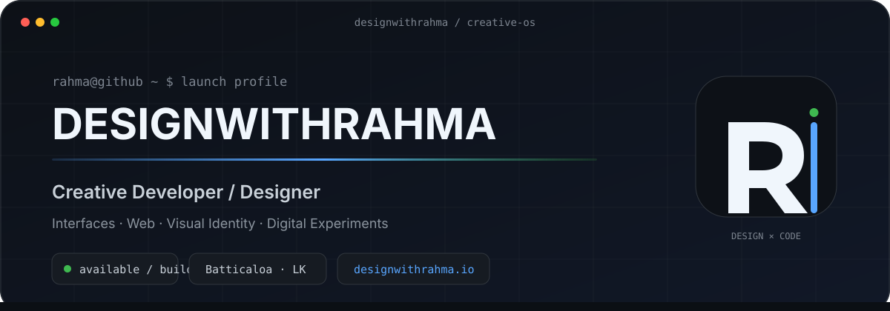
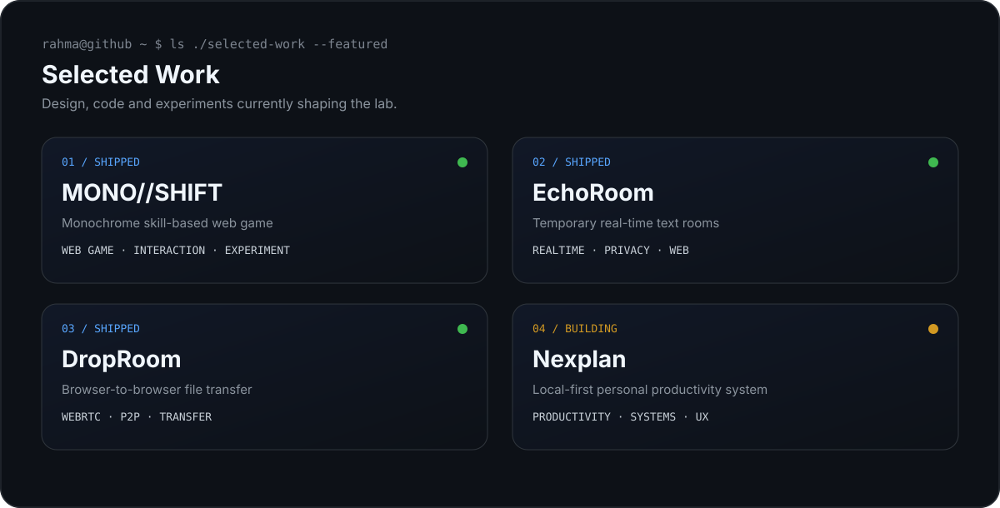
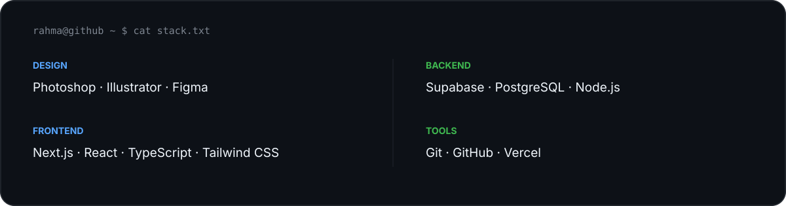

<div align="center">



<br>

[**PORTFOLIO**](https://designwithrahma.io) &nbsp;·&nbsp;
[**INSTAGRAM**](https://www.instagram.com/designwithrahma) &nbsp;·&nbsp;
[**GITHUB**](https://github.com/designwithrahma) &nbsp;·&nbsp;
[**EMAIL**](mailto:rahmathullah5975@gmail.com)

</div>

<br>

### `rahma@github ~ $ whoami`

> I work between **design and development** — creating visual identities, interfaces, web experiences and experimental digital products with a focus on clarity, interaction and detail.

```text
ROLE        Creative Developer / Designer
FOCUS       Interfaces · Web · Visual Identity
LOCATION    Batticaloa · Sri Lanka
MODE        Design × Code × Storytelling
STATUS      Building
```

<br>



<table>
<tr>
<td width="50%" valign="top">

### `MONO//SHIFT`

A monochrome skill-based web experience built around timing, movement and focused interaction.

**Status:** Shipped  
**Type:** Web Game / Experiment

[↗ Live](https://monoshift.designwithrahma.io) · [↗ Source](https://github.com/designwithrahma/mono-shift)

</td>
<td width="50%" valign="top">

### `EchoRoom`

Temporary real-time text rooms without accounts, profiles or permanent chat history.

**Status:** Shipped  
**Type:** Realtime Web App

[↗ Live](https://echoroom-designwithrahma.vercel.app)

</td>
</tr>

<tr>
<td width="50%" valign="top">

### `DropRoom`

Direct browser-to-browser file transfer using WebRTC. Signaling is used only to establish the connection.

**Status:** Shipped  
**Type:** Peer-to-Peer Utility

[↗ Live](https://droproom.designwithrahma.vercel.app)

</td>
<td width="50%" valign="top">

### `Nexplan`

A local-first personal productivity system focused on clarity, next actions and intentional planning.

**Status:** Building  
**Type:** Productivity System

`active development`

</td>
</tr>
</table>

<br>



<br>

### `rahma@github ~ $ ps --creative`

```text
PID   PROJECT        STATE      SIGNAL
001   Nexplan        BUILDING   █████████░
002   MONO//SHIFT    SHIPPED    ██████████
003   EchoRoom       SHIPPED    ██████████
004   DropRoom       SHIPPED    ██████████
```

<br>

### `rahma@github ~ $ ./contributions.sh`

<div align="center">



</div>

<br>

### `rahma@github ~ $ ./links.sh`

```text
portfolio  →  designwithrahma.io
instagram  →  @designwithrahma
github     →  @designwithrahma
email      →  contact me
```

<div align="center">

**DESIGN × CODE × STORYTELLING**

<sub>Built as a living profile — not a résumé.</sub>

<br><br>

`rahma@github ~ $ _`

</div>
